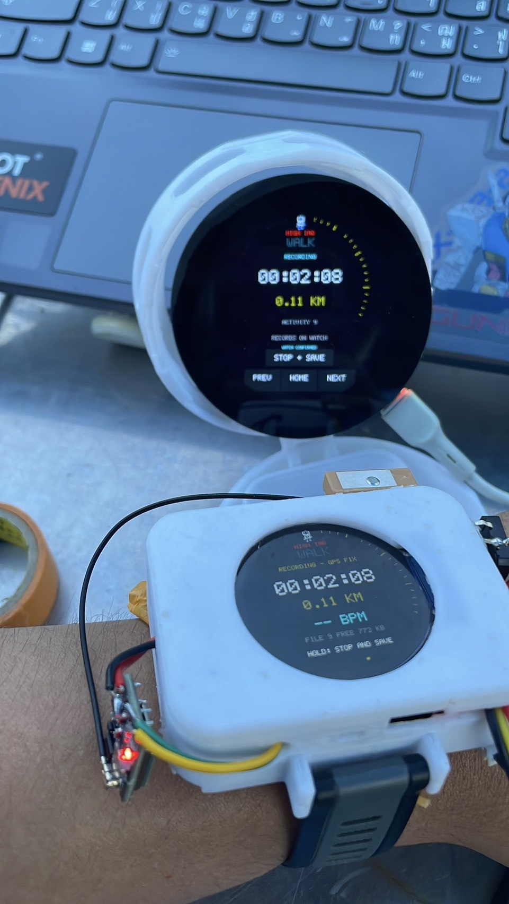
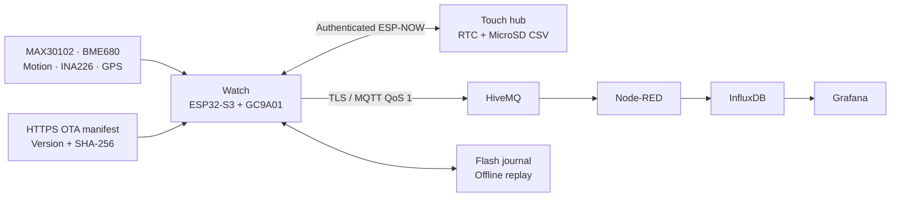

# KU Watch
### Wearable sensing · Companion display · IoT telemetry

**An ESP32-S3 prototype built from enclosure design through firmware, dashboards and measured acceptance tests.**

Private project review · Watch **2.0.15** · Hub **1.0.8** · Evidence dated **16 October 2026**

[Project journey](docs/PROJECT_JOURNEY.md) · [Demonstration videos](docs/DEMONSTRATIONS.md) · [Requirements & results](docs/VALIDATION.md) · [Build guide](docs/BUILD_AND_SETUP.md)

## Project overview

KU Watch combines a small wearable sensor node with a larger touch display and a local IoT dashboard stack. The watch measures environmental conditions, optical pulse signals, movement, battery voltage and GPS status. Data is shown locally, mirrored to the companion display and sent through authenticated MQTT for storage and visualization.

This repository is maintained as **my KU Watch project under SSRobotics**. It includes the engineering source, design records, development photographs, demonstration recordings and dated test evidence. The original Thai project records are retained as an archive; the main technical documentation is in English.

| Sensor node | Companion hub | Backend |
|---|---|---|
| ESP32-S3 Super Mini; GC9A01 round display; MAX30102; BME680; GY-51 motion module; INA226; ATGM336H GPS | Waveshare ESP32-S3-Touch-LCD-2.1; touch navigation; RTC; MicroSD CSV logging | HiveMQ MQTT; Node-RED; InfluxDB; Grafana |

## What the prototype does

- Displays live environmental, pulse/SpO2, motion, battery and GPS information with explicit unavailable/invalid states.
- Mirrors watch state to a touch-operated hub through an authenticated ESP-NOW protocol.
- Publishes timestamped JSON at a nominal one-second cadence using MQTT QoS 1 and a status/LWT topic.
- Buffers telemetry during network outages and replays captured records after reconnection.
- Records RTC-referenced environmental CSV on the hub MicroSD and supports walking-session export.
- Detects persistent temperature and IAQ threshold crossings and exposes alerts on the device and browser dashboard.
- Stores runtime settings in NVS and supports automatic HTTPS OTA with A/B application partitions.

## System architecture

See [architecture and data boundaries](docs/ARCHITECTURE.md) for the distinction between radio delivery, broker acknowledgment and database persistence.

## From design to working prototype

<table>
<tr><td width="50%"> <b>Enclosure design</b> — CAD iterations and component fit.</td><td width="50%"> <b>Hardware integration</b> — wiring, sensor discovery and powered bench tests.</td></tr>
<tr><td> <b>First backend</b> — live readings routed into dashboard widgets.</td><td> <b>Integrated system</b> — actual captured trends and diagnostic panels.</td></tr>
</table>

[Browse the complete development story and photographs →](docs/PROJECT_JOURNEY.md)

## Measured results

| Test | Recorded result | Scope |
|---|---|---|
| FR-01 sensing and display | **69.704 s** continuously valid pulse/SpO2 window; **24.916 Hz** optical samples; conservative display interval bound **861 ms** | Actual version 2.0.15 hardware observation; fingertip bench test |
| FR-03 MQTT reception | **300 / 300** live records over **300 s**; no missing IDs or disconnects | Latest five-minute run; receiver on home Wi-Fi |
| FR-05 outage recovery | **614.0 s** actual Wi-Fi outage; **852** backfilled IDs; **877** complete database IDs in the checked window | Dated 2.0.9 acceptance evidence retained |
| FR-06 alerts | **2 / 2** scenarios passed; worst observed display **2.95 s**, browser **2.66 s** | Explicitly simulated inputs, as allowed by the requirement |
| FR-08 automatic OTA | **2.0.14 → 2.0.15**, approximately **88 s**, SHA-256 verified | Automatic Wi-Fi update and user confirmation on both displays |

All eight functional requirements have scoped acceptance evidence. **This does not mean that every non-functional requirement is complete.** Battery endurance, calibration, continuous 24-hour operation and power-interruption rollback tests remain separate. The cumulative MQTT reception total must never be described as continuous 24-hour use.

The pulse and SpO2 values are experimental estimates. The accepted fingertip test does not establish reliable wrist measurement or clinical accuracy.

[Read the full acceptance matrix, failed attempts and remaining work →](docs/VALIDATION.md)

## Watch the demonstrations

<table>
<tr><td width="50%"><a href="media/videos/pulse-demo.mp4"> Pulse values on both displays · 13 s</a></td><td width="50%"><a href="media/videos/grafana-live-60s.mp4"> Grafana values changing over time · 60 s</a></td></tr>
</table>

[All nine clips, with context and duration →](docs/DEMONSTRATIONS.md) · [Every captured dashboard panel →](docs/DASHBOARD_GALLERY.md)

## Repository guide

| Location | Contents |
|---|---|
| [`src/`](src/) and [`include/`](include/) | Watch firmware and modular services |
| [`large_display/KU_Hub/`](large_display/KU_Hub/) | Companion display firmware |
| [`hardware/`](hardware/) | KiCad sources, drawing and schematic records |
| [`integration/`](integration/) | Credential-free Node-RED and Grafana configuration |
| [`tests/`](tests/) | Host unit tests and integration checks |
| [`tools/`](tools/) | Build, observation, maintenance and evidence tools |
| [`media/`](media/) | Actual project photographs, screenshots and videos |
| [`evidence/`](evidence/) | Dated observations, including failed and partial attempts |
| [`docs/`](docs/) | English engineering documentation and media guides |
| [`archive/`](archive/) | Original project acceptance documents and dated material |

Start with [build and setup](docs/BUILD_AND_SETUP.md), [hardware wiring](docs/HARDWARE.md), [testing](docs/TESTING.md), and [handoff notes](docs/HANDOFF.md). Large original presentations and the verified handoff ZIP are listed in the [private review release](https://github.com/SSRobotic/ku-watch/releases/tag/v2.0.15-private-review).

## Configuration and ownership

The repository contains templates and references, not live credentials, private TLS keys, device flash backups or raw personal activity exports. Follow [configuration and security](docs/CONFIGURATION.md) before compiling for your own devices. Historical maintenance scripts may contain workstation-specific paths and verified device MAC guards; inspect them before reuse.

Copyright (c) 2026 **SSRobotics**. Original project materials are reserved for private review. See [ownership](COPYRIGHT.md) and [third-party notices](THIRD_PARTY_NOTICES.md).
