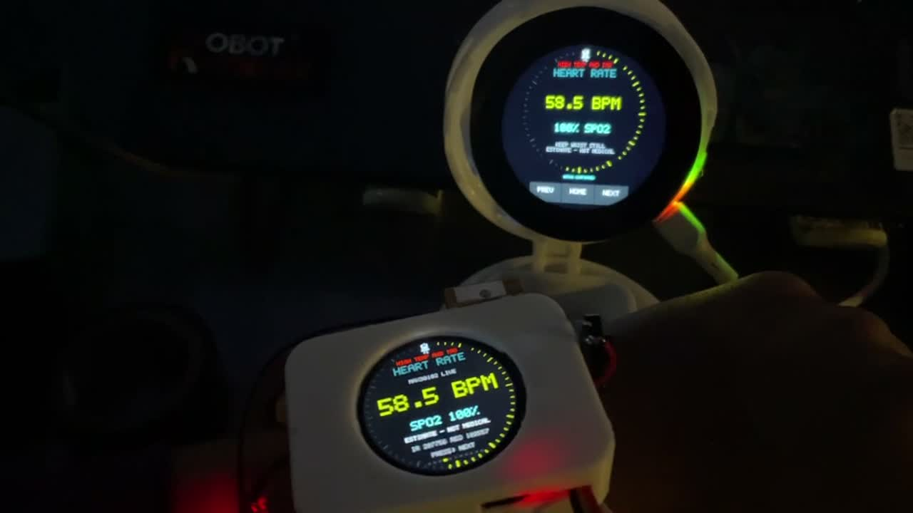
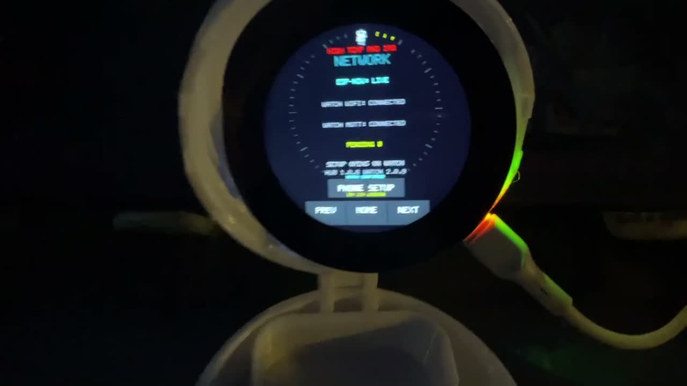
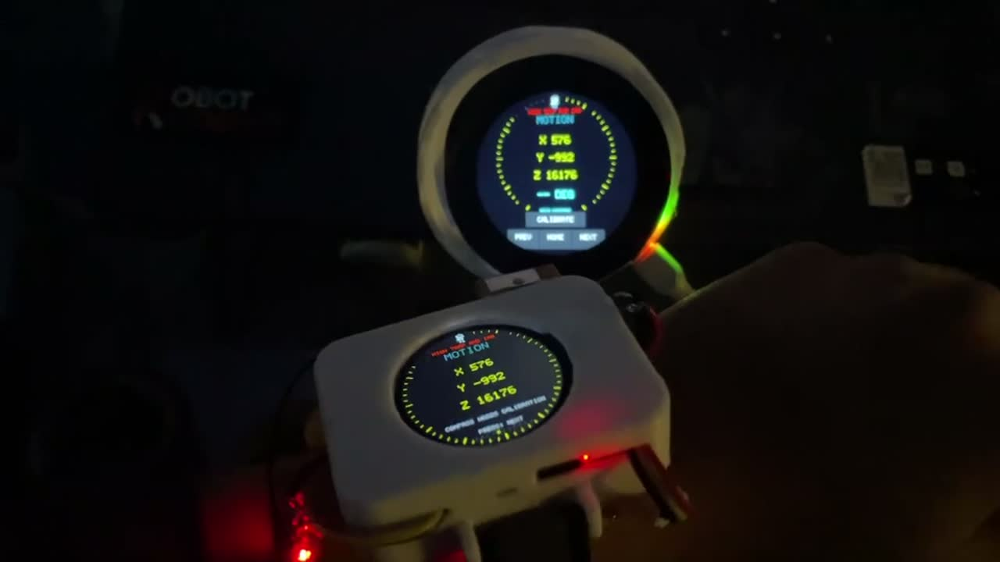
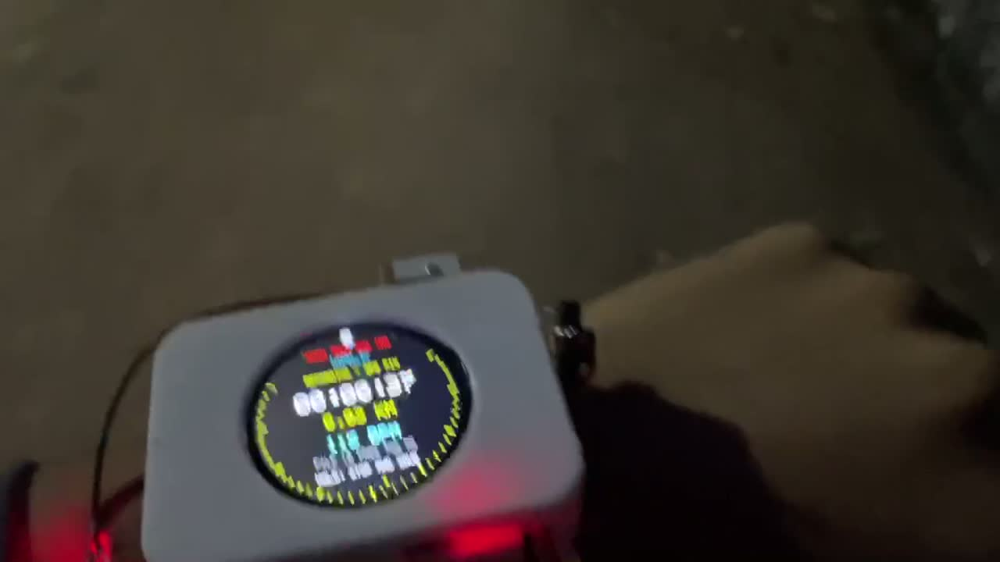
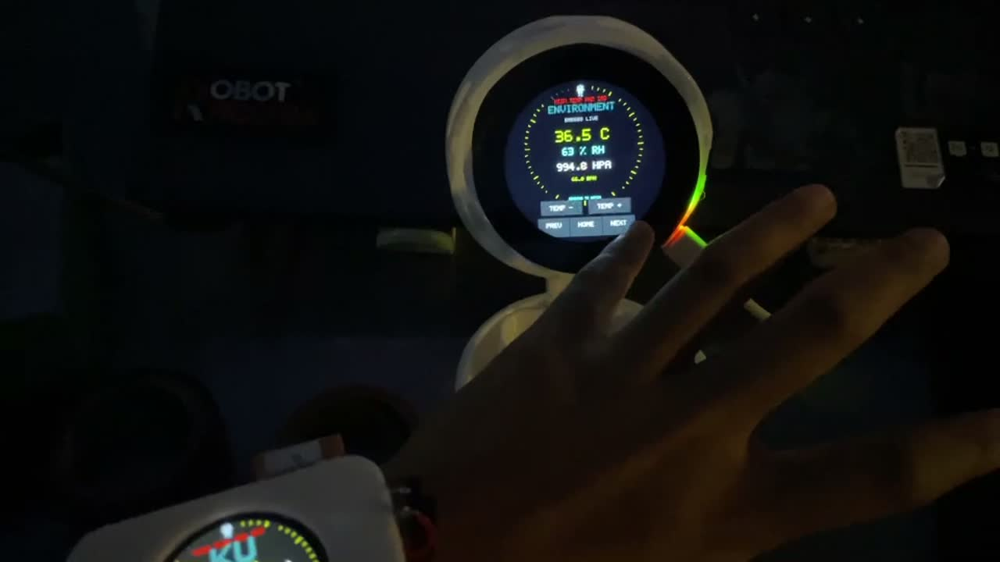
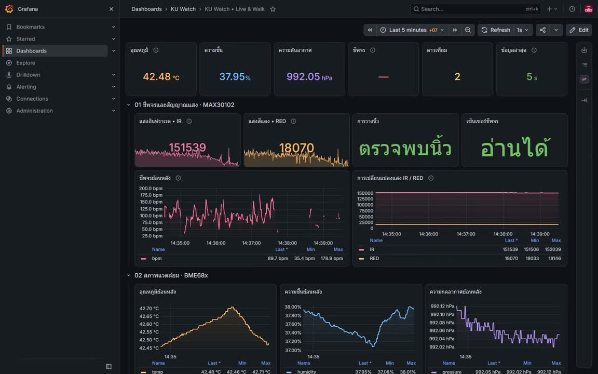
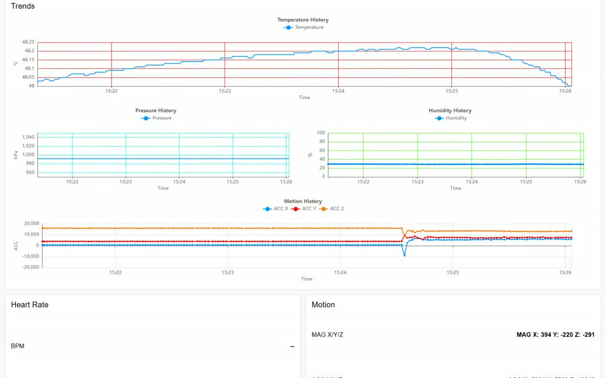
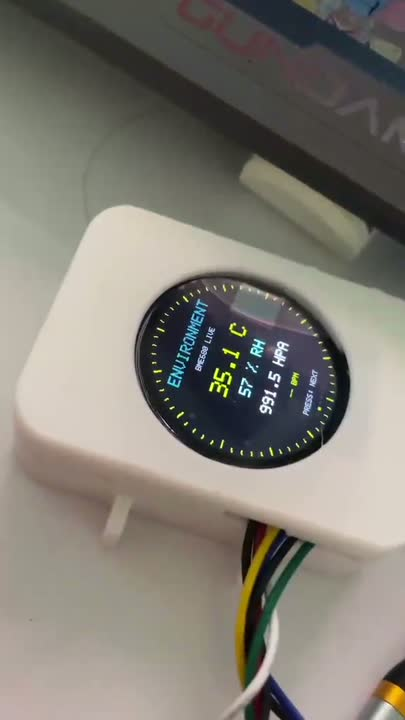
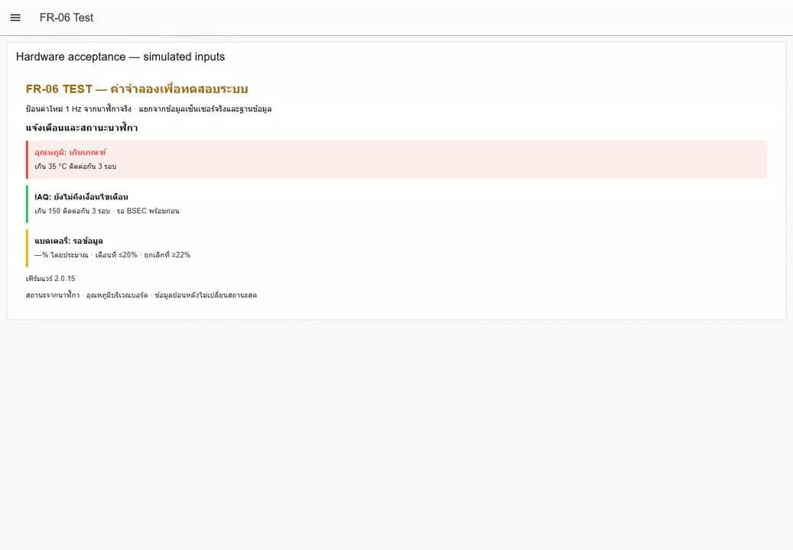

# Demonstration recordings

These are actual user/device/browser recordings. They complement the quantitative evidence; they do not expand the acceptance scope. Historical UI language and measured values are retained. Click a poster to open/download its MP4.

## Pulse Demo

Pulse estimate mirrored on both physical displays; demonstration, not clinical validation. **Duration: 13.28 s.** [MP4](../media/videos/pulse-demo.mp4)

## Network Connection Demo

Wi-Fi and MQTT connection status and local setup access; historical demonstration. **Duration: 7.07 s.** [MP4](../media/videos/network-connection-demo.mp4)

## Motion Demo

Motion sensor values changing on the prototype. **Duration: 8.84 s.** [MP4](../media/videos/motion-demo.mp4)

## Walking And Gps Demo

Outdoor walking session and GPS-related operation; historical demonstration. **Duration: 174.84 s.** [MP4](../media/videos/walking-and-gps-demo.mp4)

## Environment Demo

Environmental values displayed on both devices. **Duration: 12.64 s.** [MP4](../media/videos/environment-demo.mp4)

## Grafana Live 60S

Actual Grafana values and trends changing over approximately 60 seconds. **Duration: 59.96 s.** [MP4](../media/videos/grafana-live-60s.mp4)

## Node Red Recovery 60S

Actual Node-RED dashboard after online recovery, recorded for 60 seconds. **Duration: 60.00 s.** [MP4](../media/videos/node-red-recovery-60s.mp4)

## Development Prototype 30S

Earlier open-case prototype and initial backend integration. **Duration: 30.23 s.** [MP4](../media/videos/development-prototype-30s.mp4)

## Fr06 Alert Test 2.0.15

Actual browser response to explicitly simulated temperature and IAQ inputs on version 2.0.15. **Duration: 22.32 s.** [MP4](../media/videos/fr06-alert-test-2.0.15.mp4)
